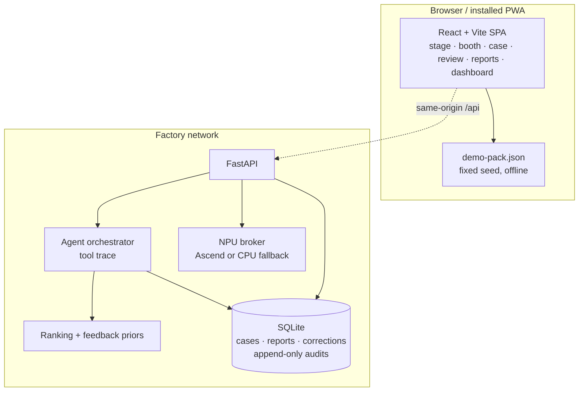

# Architecture

## Shape



The public site runs the UI against a static pack. The on-site deployment serves the same UI and
exposes `/api`; the case workspace then reads from SQLite.

## Server modules

| Module | Responsibility |
|---|---|
| `api/app.py` | Routes, uploads, exports, connector tests, static SPA |
| `engine/ranking.py` | Five-factor scoring, softmax confidence, “none of these” bucket |
| `engine/investigation.py` | Time-window aggregation, batch linker, similar-case search |
| `engine/orchestrator.py` | Deterministic trace, tool calls, rejection re-rank |
| `engine/feedback.py` | Historical rejection priors |
| `engine/detection.py` | Synthetic image generation + Otsu/connected-component detector |
| `engine/reporting.py` | HTML / Markdown / PDF / DOCX / RTF renderers |
| `engine/analytics.py` | Savings, trends, cross-line patterns, compliance maps, sharing payload |
| `connectors/__init__.py` | OPC-UA, Modbus, camera, CSV, REST, SAP, FactoryTalk, S7, normalisation |
| `store/db.py` | SQLite schema, seeding, append-only triggers, report versions, corrections |
| `npu/broker.py` | Local and Ascend inference contract |
| `npu/service.py` | On-site broker service (`/health`, `/infer`) |
| `training/finetune.py` | Customer-specific detector training and Ascend export |

## Ranking

```
score = Σ weight_i × factor_i / Σ weights
weights = deviation .30, frequency .28, batch .18, similarity .18, recurrence .06
confidence = softmax(score / T) with T = max(.11, .22 × max(score))
             plus a constant .30 “none of these” bucket
```

Rejections multiply the score by `.16` and are stored as corrections. Historical corrections apply
a prior penalty of 12% per rejection, capped at 45%, across all factors.

The factors are deliberately legible. An engineer can ask “why is this first?” and get five numbers
backed by evidence IDs.

## Investigation trace

1. `detector.detect` — the defect and confidence.
2. `opcua.read_window` — machine state around the timestamp; z-scores and spec breaches.
3. `mes.batch` — batch record and exceptions.
4. `cmms.history` — maintenance events with a plausible process effect.
5. `similar.search` — historical cases.
6. `cause.rank` — the first list.
7. `engineer.reject` / `cause.rerank` — only if the human rejects.
8. `engineer.check` — always waiting for a human. The AI cannot approve.

## Storage and audit

- `cases` holds the scenario payload, status and timestamps.
- `hypotheses` holds each cause's status and score.
- `reports` is keyed by `(id, version)`; every save creates a row.
- `audits` is append-only **at the database level**: `BEFORE UPDATE` and `BEFORE DELETE` triggers
  raise `ABORT`. Even a SQL console cannot rewrite history without dropping the schema.
- `corrections` records the rejection reason, actor and the full re-ranked payload.
- `baselines` records the pre-pilot investigation time per line.

## API surface

```
GET  /api/health
GET  /api/pack
GET  /api/scenarios                  POST /api/scenarios/{id}/investigate
GET  /api/cases                      GET  /api/cases/{id}
POST /api/cases/{id}/reject          POST /api/cases/{id}/accept
POST /api/cases/{id}/manual          POST /api/cases/{id}/approve
GET  /api/reports/{case}             PATCH /api/reports/{case}
GET  /api/reports/{case}/{html,markdown,pdf,docx}
GET  /api/audits                     GET  /api/corrections
GET  /api/dashboard                  POST /api/alerts/{id}/ack
GET  /api/connectors                 POST /api/connectors/{id}/test
GET  /api/npu/health                 POST /api/detect
POST /api/investigate/new            GET  /api/compliance/{pack}
GET  /api/sharing                    POST /api/sharing
GET  /api/tenants
GET  /api/export/cases.csv
```

## Security posture

- No authentication in the public demo; it has no customer data and no write-behind server.
- On site, put the API behind the factory reverse proxy and SSO. The audit trail records named
  actors; integrate the identity provider at the proxy and pass the verified name.
- The NPU broker binds to `127.0.0.1` by default and refuses to pretend the CPU is an NPU.
- No outbound network is required after setup. No cloud inference. No telemetry.
- Uploaded images are processed and deleted; the demo returns a detection and does not retain the
  file.

## Multi-line and multi-factory

- Lines are first-class (`line_id`) and every case, sensor window and report is scoped to a line.
- The dashboard has separate channels per line and cross-line pattern detection.
- Tenants are isolated at the file level: the `X-RootCause-Tenant` header selects a separate SQLite
  database (`runtime/tenants/<tenant>.sqlite3`). There is no shared table with a tenant column to
  forget in a `WHERE` clause. `GET /api/tenants` lists what the site allows.
- Phase 3 multi-factory deployment is one customer, not a public SaaS. Data isolation is per site;
  cross-factory sharing is opt-in, anonymised and limited to cause labels and factor ranges.
- Full multi-tenant SaaS with factory data in a shared cloud is explicitly **not planned** — it
  contradicts the data-sovereignty pitch.
