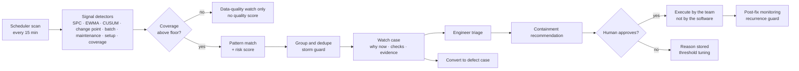

# Proactive quality — implementation notes

**The product sentence.** Reactive to defects, proactive about risk — never in control of the line.

RootCause now has a proactive quality layer. It watches process changes, parameter drift, material
risk, maintenance context and coverage; it opens a **watch case** before a defect exists, assembles
the evidence, suggests checks and recommends containment. A named engineer decides. No watch can
change a setpoint, reject a part or hold a batch by itself.

## The workflow

## Components

| Component | Path | What it does |
|---|---|---|
| Signal detectors | `server/rootcause/proactive/signals.py` | EWMA, CUSUM, change point, recent/peak deviation, golden fingerprint, dedupe |
| Scheduler / replay | `server/rootcause/proactive/scheduler.py` | Pattern matching, dedupe, coverage suppression, storm guard, scan runs, replay |
| Watch workflow | `server/rootcause/proactive/watch.py` | Build, triage, snooze, dismiss, convert, true-risk, SLA |
| Containment | `server/rootcause/proactive/containment.py` | Playbooks, impact estimates, approve/execute/verify, exposure, corrective draft, supplier notice, recurrence guard |
| Notifications | `server/rootcause/proactive/notifications.py` | Dedup, quiet hours, signed webhooks |
| Shift brief | `server/rootcause/proactive/brief.py` | Generated brief and Markdown |
| Metrics | `server/rootcause/proactive/metrics.py` | Precision, alert fatigue, drift, coverage, tuning, follow-up effectiveness |
| Offline queue | `server/rootcause/proactive/queue.py` | Bounded edge buffer |
| Store | `server/rootcause/store/db.py` | Watch, recommendation, scan, notification, follow-up and settings tables |
| API | `server/rootcause/api/app.py` | Watchlist, watch detail, triage, containment, brief, alerts, settings, research |
| UI | `web/src/pages/Watchlist.tsx`, `WatchDetail.tsx`, `ShiftBrief.tsx`, `Alerts.tsx`, `ProactiveDashboard.tsx`, `ProactiveBooth.tsx` | The operator surface |

## The five questions

Every alert must answer:

1. What changed?
2. Why now?
3. What evidence supports it?
4. What is the recommended check or containment?
5. What would make this a false alarm?

If it cannot answer all five, it does not alert.

## Guardrails

- Recommendations only; the engineer approves. No line control, automatic rejection or automatic
  batch hold.
- Coverage below the floor suppresses quality alerts. A data-quality watch is opened instead.
- Deduplication by `line:pattern`; storm protection caps alerts per shift and falls back to a digest.
- The scheduler has a dead-man's switch and a one-switch stop that leaves defect cases untouched.
- Every watch, recommendation, approval, dismissal and follow-up is in the append-only audit.
- Prediction is gated research, not a product path. The current gate is stopped.

## Demo data

The public pack includes 13 watches, 6 patterns, 8 recommendations, two exposures, three follow-ups,
notifications, scan runs, coverage, model cards and a stopped research gate. The story is coherent:
hydrogen drift was visible five hours before RC-0417; containment held the rest of the batch.

## Tests

- Signal determinism and detection
- Watch lifecycle and storm guard
- Containment approval and exposure
- Shift brief and notification dedup/quiet hours/signatures
- Scheduler dedupe and replay
- Research data audit and stop rule
- API flows: watchlist, detail, triage, dismiss, convert, recommendation approve/execute, brief,
  notifications, stop/start, threshold update, research, exposure release
- Store seeding, settings, outcomes and append-only audit
